<div align="center">

# 🏄 MCP Surf Forecast

**The AI-powered surf companion that knows every break on the planet.**

An MCP server that gives LLMs real-time surf intelligence — wave quality scoring, beach discovery, session planning, and forecast analysis across 12+ global data sources.

[](https://nodejs.org/)
[](https://github.com/PrefectHQ/fastmcp-ts)
[](LICENSE)
[](https://github.com/YOUR_ORG/mcp-surf-forecast/actions)
[](https://github.com/YOUR_ORG/mcp-surf-forecast/actions/workflows/qodana.yml)

[Quick Start](#-quick-start) · [Features](#-features) · [Tools](#-tools) · [Prompts](#-prompts) · [Configuration](#%EF%B8%8F-configuration) · [Contributing](#-contributing)

</div>

---

## 🌊 What is this?

**MCP Surf Forecast** turns any AI assistant into a surf-savvy copilot. It's a [Model Context Protocol](https://modelcontextprotocol.io/) server that exposes surf data, smart tools, and planning prompts — so Claude, Cursor, ChatGPT, or any MCP client can help you find the perfect wave.

```
You: "What's the best spot near Lisbon this morning?"

AI: Using wave_quality_index and classify_best_spot_nearby...

🏆 #1 Coxos (Ericeira) — WQI 8.2/10 "Very Good"
   6ft+ sets, 14s period, light NE offshore
   Best window: 07:00–10:30 (dropping tide)

🥈 #2 Supertubos (Peniche) — WQI 7.8/10 "Very Good"
   Hollow barrels, overhead, advanced surfers only

🥉 #3 Carcavelos — WQI 6.1/10 "Good"
   Fun peaks, 3-4ft, great for all levels
```

---

## ✨ Features

### 🎯 Wave Quality Index (0–10)

A proprietary scoring algorithm that condenses swell, wind, tide, consistency, and direction into one number. No more cross-referencing 5 tabs — just ask "how good is it?"

| Score | Label | You should... |
|-------|-------|---------------|
| 8–10 | Very Good / Epic | Drop everything and go |
| 6–7 | Good | Great session guaranteed |
| 4–5 | Fair | Fun if you're not picky |
| 2–3 | Poor | Maybe do yoga instead |
| 0–1 | Flat | Definitely do yoga |

### 🌍 Global Coverage

Data aggregated from 12+ providers across every major surf region:

| Region | Providers |
|--------|-----------|
| 🌐 Global | Surfline, Surf-Forecast, Magicseaweed |
| 🇪🇺 Europe | MeoSurf, Windguru |
| 🇧🇷 Brazil | Waves.com.br |
| 🇦🇺 Australia | Coastalwatch, Swellnet |
| 🇺🇸 Hawaii | Surfnewsnetwork |
| 🇮🇩 Indonesia | Baliwaves |
| 🇿🇦 Africa | Wavescape |

### 🧠 Smart Classification

Not just data — intelligence. The server tells you *where to go* based on your skill level, location, and current conditions. Beginners get safe recommendations; pros get the heavy spots.

---

## 🛠 Tools

| Tool | What it does |
|------|-------------|
| `wave_quality_index` | Score any beach 0–10 with full breakdown |
| `classify_best_spot_nearby` | Ranked spots by quality within your radius |
| `classify_spot_for_skill` | Go / Caution / Avoid for your level |
| `find_beaches_in_radius` | Discover spots near GPS coordinates |
| `find_beaches_near_city` | Same, but from a city name |
| `filter_beaches` | Multi-criteria search (region, wave type, skill) |
| `best_sessions_today` | Optimal windows considering tide + wind |
| `compare_beaches` | Side-by-side forecast comparison |
| `check_swell_alert` | Upcoming swell notifications |
| `wetsuit_recommendation` | Gear advice based on water temp + wind chill |
| `surf_conditions_full` | Complete conditions in one call |

### Tool Sequence Diagrams

#### `wave_quality_index`

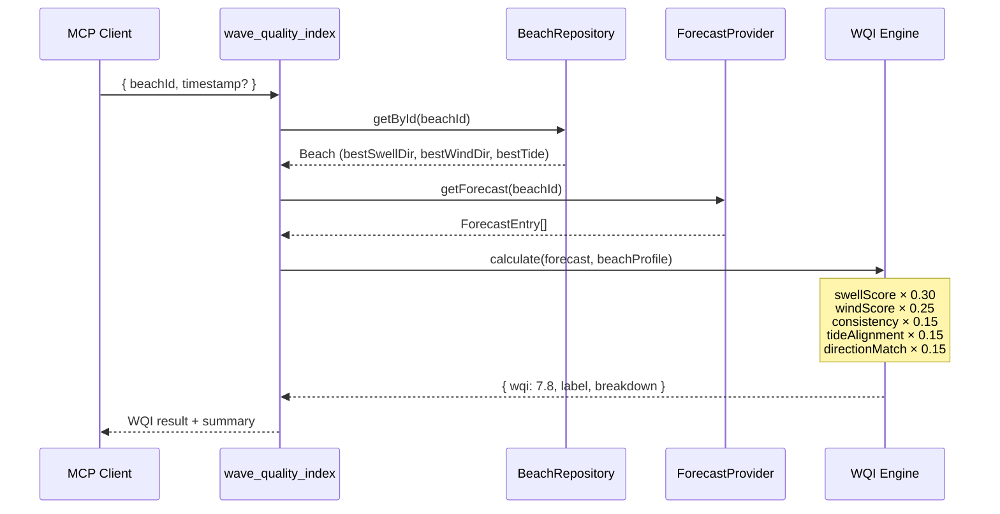

#### `classify_best_spot_nearby`

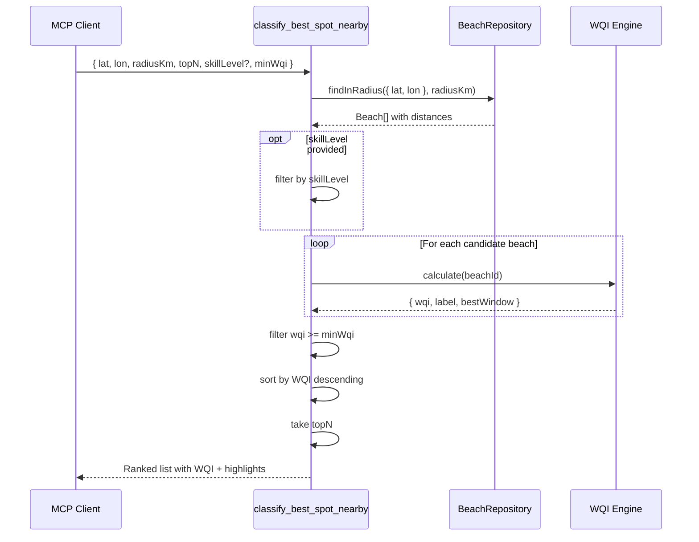

#### `classify_spot_for_skill`

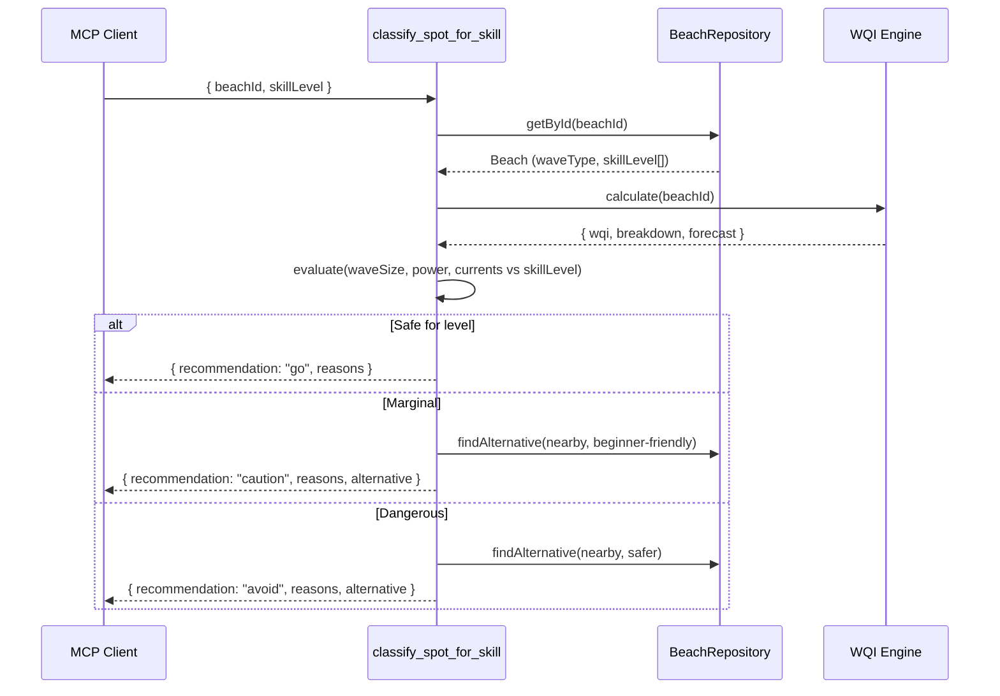

#### `find_beaches_in_radius`

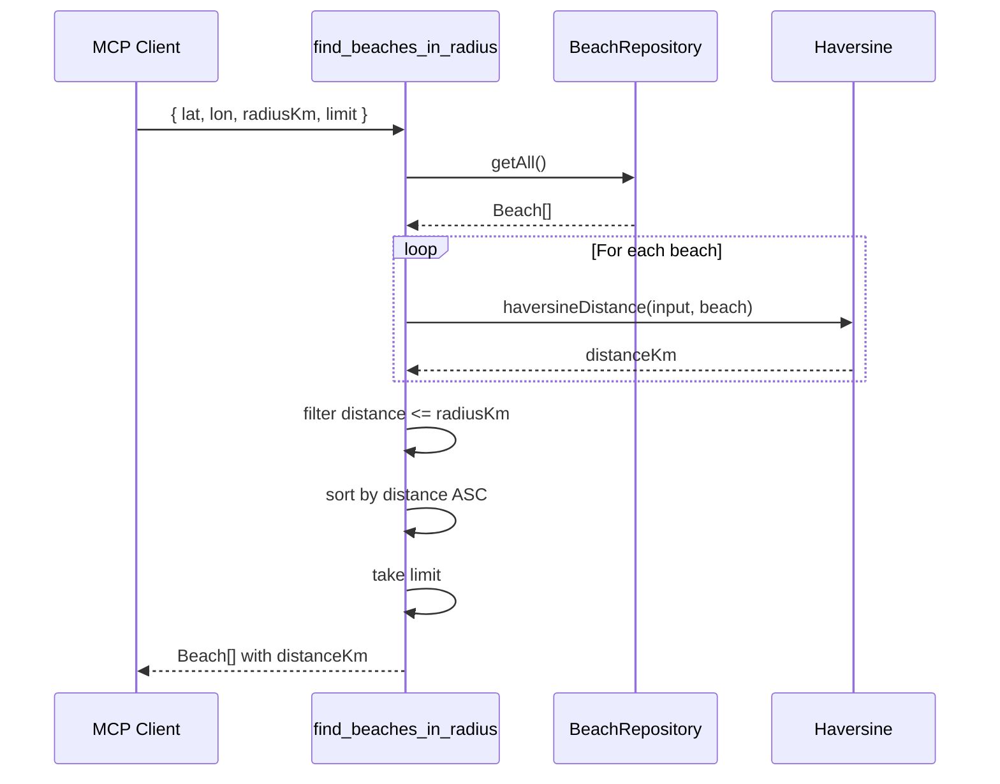

#### `find_beaches_near_city`

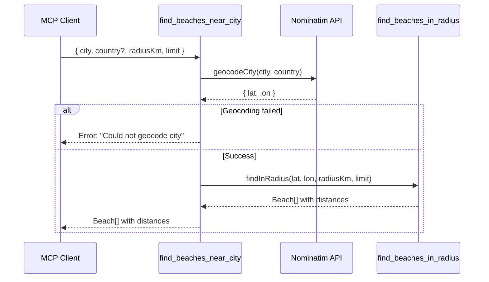

#### `filter_beaches`

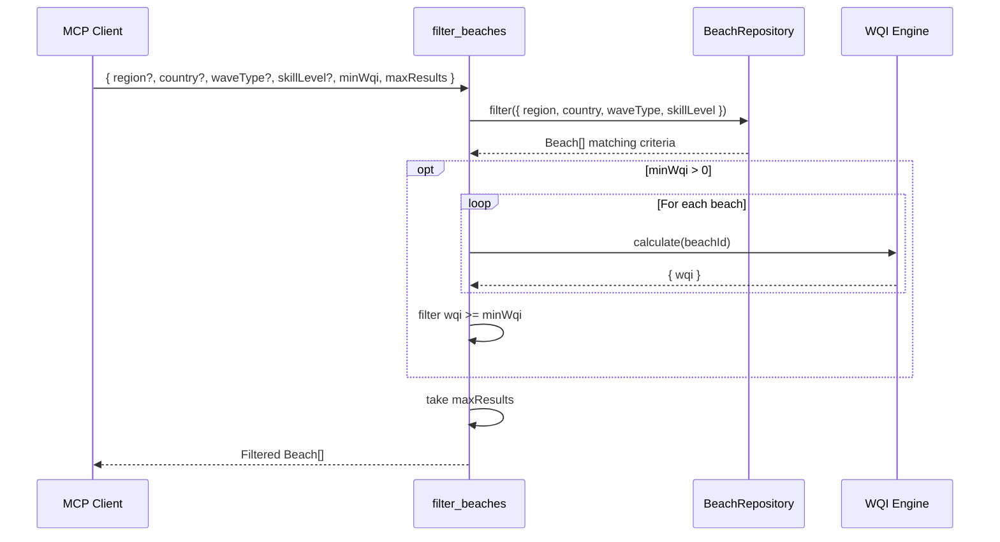

#### `best_sessions_today`

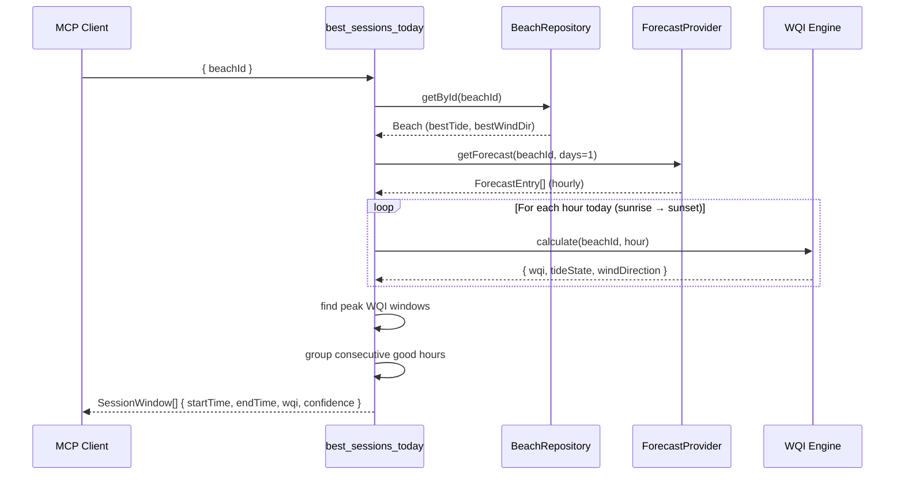

#### `compare_beaches`

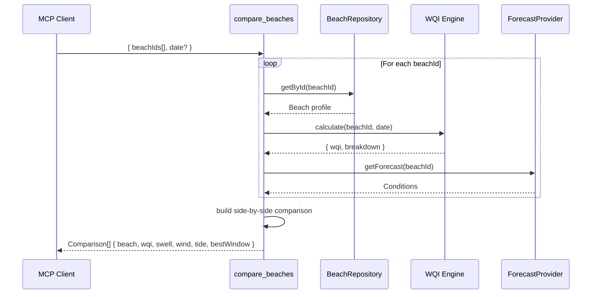

#### `check_swell_alert`

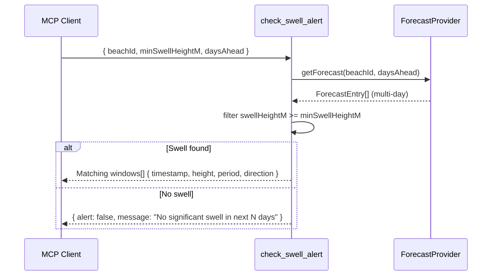

#### `wetsuit_recommendation`

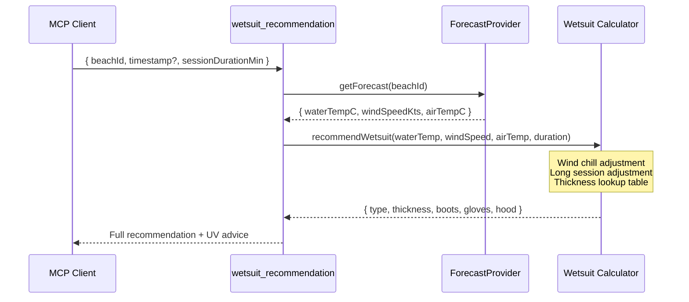

#### `surf_conditions_full`

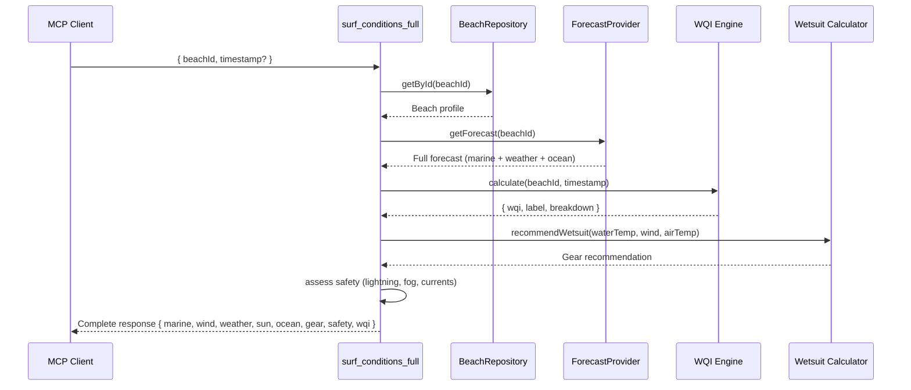

---

## 💬 Prompts

Pre-built conversation starters that turn your AI into a surf expert:

| Prompt | Use case |
|--------|----------|
| `plan_surf_trip` | Multi-day itinerary with forecasts |
| `daily_surf_report` | Morning conditions check |
| `analyze_spot` | Deep dive on a specific break |
| `beginner_spot_finder` | Safe spots for learners |

---

## 🚀 Quick Start

### Prerequisites

- **Node.js 22+** ([download](https://nodejs.org/))
- **npm** or **pnpm**

### Install

```bash
git clone https://github.com/YOUR_ORG/mcp-surf-forecast.git
cd mcp-surf-forecast
npm install
```

### Run the server

```bash
# stdio transport (for Claude Desktop, Cursor, etc.)
npm start

# HTTP transport (for network clients, debugging)
npm run start:http
# → Server running at http://localhost:3000

# Interactive Inspector UI (development)
npm run dev
```

### Connect your AI client

**Claude Desktop** — add to your `mcp.json`:

```json
{
  "mcpServers": {
    "surf-forecast": {
      "command": "npx",
      "args": ["fastmcp", "run", "/path/to/mcp-surf-forecast/src/server.ts"]
    }
  }
}
```

**Cursor / HTTP clients:**

```json
{
  "mcpServers": {
    "surf-forecast": {
      "url": "http://localhost:3000"
    }
  }
}
```

---

## 🧪 Testing

### Run tests locally

```bash
# Run all tests
npm test

# Run tests in watch mode (re-runs on file change)
npm run test:watch

# Run tests with coverage report
npm run test:coverage

# Type check (no emit)
npm run typecheck
```

### Test structure

```
tests/
├── unit/          # Pure logic: WQI engine, geo math, schemas
├── integration/   # Tools + resources with mock data
└── e2e/           # Full MCP server via client connection
```

### Verify MCP compliance

```bash
# List all registered resources, tools, and prompts
npm run inspect

# Call a specific tool from terminal
npx fastmcp call wave_quality_index --file src/server.ts beachId=supertubos-peniche

# Open the visual Inspector UI
npm run dev
```

---

## 🔍 MCP Inspector

The [FastMCP Inspector](https://github.com/PrefectHQ/fastmcp-ts) is a visual development tool that lets you browse, test, and debug all your MCP components interactively — without needing an AI client connected.

### Launch the Inspector

```bash
npm run dev
```

This opens a browser-based UI with hot reload. Every time you save a file, the Inspector reloads your server automatically.

### What you can do in the Inspector

| Feature | How |
|---------|-----|
| 📋 Browse all tools, resources & prompts | Listed in the sidebar with schemas |
| 🧪 Call any tool with custom params | Fill in the form, hit "Run", see the response |
| 📖 Read any resource by URI | Type `surf://beaches/supertubos-peniche` and see the data |
| 💬 Render prompts with arguments | Preview exactly what the LLM receives |
| ❌ Test error handling | Pass invalid params and verify error messages |
| ⏱️ Check response times | Each call shows execution duration |

### Inspector from the terminal (headless)

If you prefer CLI over UI:

```bash
# List everything the server exposes
npx fastmcp inspect --file src/server.ts

# Output:
# Tools (9):
#   - wave_quality_index
#   - classify_best_spot_nearby
#   - classify_spot_for_skill
#   - find_beaches_in_radius
#   - find_beaches_near_city
#   - filter_beaches
#   - best_sessions_today
#   - compare_beaches
#   - check_swell_alert
#
# Resources (6):
#   - surf://providers
#   - surf://providers/{providerId}
#   - surf://beaches
#   - surf://beaches/{beachId}
#   - surf://forecast/{beachId}
#   - surf://cams/{beachId}
#
# Prompts (4):
#   - plan_surf_trip
#   - daily_surf_report
#   - analyze_spot
#   - beginner_spot_finder
```

### Call tools directly from terminal

```bash
# Score a beach
npx fastmcp call wave_quality_index --file src/server.ts beachId=supertubos-peniche

# Find beaches near coordinates
npx fastmcp call find_beaches_in_radius --file src/server.ts lat=38.7 lon=-9.14 radiusKm=50

# Classify for a beginner
npx fastmcp call classify_spot_for_skill --file src/server.ts beachId=carcavelos skillLevel=beginner

# Check upcoming swell
npx fastmcp call check_swell_alert --file src/server.ts beachId=pipeline-oahu minSwellHeightM=3 daysAhead=5
```

### Run server locally for HTTP clients

```bash
# Start on port 3000 (default)
npm run start:http

# Or specify a custom port
PORT=8080 npx fastmcp run src/server.ts --transport http --port 8080
```

Then test with curl:

```bash
# Health check (server is up)
curl http://localhost:3000

# Or connect a FastMCP client
npx fastmcp call wave_quality_index --url http://localhost:3000 beachId=coxos-ericeira
```

---

## ⚙️ Configuration

### Environment Variables

| Variable | Required | Default | Description |
|----------|----------|---------|-------------|
| `PORT` | No | `3000` | HTTP transport port |
| `TRANSPORT` | No | `stdio` | Transport type: `stdio` or `http` |
| `LOG_LEVEL` | No | `info` | Logging level: `debug`, `info`, `warn`, `error` |
| `NOMINATIM_USER_AGENT` | No | `mcp-surf-forecast` | User-Agent for geocoding requests |
| `QODANA_TOKEN` | CI only | — | Qodana Cloud authentication token |
| `SEMGREP_APP_TOKEN` | CI only | — | Semgrep security scanning token |

### qodana.yaml

```yaml
version: "1.0"
profile:
  name: qodana.starter
linter: jetbrains/qodana-jvm-community:2025.3
```

### Data Configuration

The beach database and provider registry live in `src/data/`:

- **`beaches.json`** — Static database of ~50-100 surf spots worldwide
- **`providers.json`** — Metadata for all data source providers

To add a new beach, just append to `beaches.json`:

```json
{
  "id": "your-spot-name",
  "name": "Your Spot",
  "region": "Europe",
  "country": "Portugal",
  "lat": 39.36,
  "lon": -9.37,
  "waveType": ["beach-break"],
  "skillLevel": ["intermediate"],
  "bestTide": "mid",
  "bestSwellDir": "NW",
  "bestWindDir": "E",
  "providers": ["surfline", "windguru"],
  "camUrl": null
}
```

No code changes required — the server picks it up automatically.

### WQI Weights

The Wave Quality Index scoring weights are defined in `src/tools/wqi.ts`:

```typescript
const WQI_WEIGHTS = {
  swellScore:     0.30,   // Wave height + period
  windScore:      0.25,   // Offshore vs onshore
  consistency:    0.15,   // Set frequency
  tideAlignment:  0.15,   // Current vs ideal tide
  directionMatch: 0.15,   // Swell direction vs spot's sweet spot
}
```

---

## 📁 Project Structure

```
src/
├── server.ts          # Composition root — wires everything together
├── resources/         # MCP resources (read-only data endpoints)
├── tools/             # MCP tools (computation & actions)
├── prompts/           # MCP prompts (LLM interaction templates)
├── models/            # Domain entities & Zod schemas
├── providers/         # Data access layer (static JSON for MVP)
├── data/              # Beach & provider JSON databases
└── utils/             # Geo math, geocoding, helpers
```

> Full architecture details in [docs/01-architecture.md](docs/01-architecture.md)

---

## 🏗 Built With

| | Technology | Why |
|-|-----------|-----|
| 🔌 | [FastMCP TypeScript](https://github.com/PrefectHQ/fastmcp-ts) | The standard MCP framework |
| 🛡️ | [Zod](https://zod.dev) | Runtime schema validation |
| 🌐 | [Haversine](https://www.npmjs.com/package/haversine) | Geographic distance calculations |
| 🧪 | [Vitest](https://vitest.dev) | Lightning-fast testing |
| 📊 | [Qodana](https://www.jetbrains.com/qodana/) | Code quality & security |

---

## 🤝 Contributing

We welcome contributions! Whether it's adding new beaches, improving the WQI algorithm, or integrating real-time data sources.

### How to contribute

1. Fork the repo
2. Create a feature branch (`git checkout -b feature/add-bali-spots`)
3. Make your changes
4. Run tests (`npm test`) and type check (`npm run typecheck`)
5. Open a PR

### Easy first contributions

- 🏖️ **Add beaches** — Drop entries into `src/data/beaches.json` (no code needed!)
- 🌊 **Tune WQI** — Improve scoring accuracy for specific wave types
- 🌍 **Add providers** — Implement a new `ForecastProvider` for a data source
- 📝 **Improve prompts** — Better LLM guidance for surf planning

### Development workflow

```bash
npm run dev          # Inspector UI with hot reload
npm test             # Run test suite
npm run test:watch   # Tests re-run on save
npm run inspect      # Validate all MCP components
```

---

## 📋 Roadmap

- [x] Static beach database (50+ spots worldwide)
- [x] Wave Quality Index (0–10 scoring)
- [x] Geo-based search & classification
- [x] Parameterized prompts for trip planning
- [ ] Real-time Surfline API integration
- [ ] Live cam snapshot analysis
- [ ] Historical data & trend analysis
- [ ] User favorites & personalized alerts
- [ ] Multi-language support
- [ ] Mobile companion app

---

## 📄 Documentation

Full technical documentation lives in [`docs/`](docs/INDEX.md):

| Document | Topic |
|----------|-------|
| [Architecture](docs/01-architecture.md) | System design & SOLID principles |
| [Data Models](docs/02-data-models.md) | Beach, Forecast, WQI schemas |
| [Resources](docs/03-resources.md) | MCP data endpoints |
| [Tools](docs/04-tools.md) | Computation & classification |
| [WQI Spec](docs/05-wqi-spec.md) | Scoring algorithm deep-dive |
| [Prompts](docs/06-prompts.md) | LLM interaction templates |
| [Testing](docs/07-inspector-testing.md) | CI, Qodana, test strategy |
| [Project Setup](docs/08-project-setup.md) | Dev environment & config |

---

## 📜 License

MIT — see [LICENSE](LICENSE) for details.

---

<div align="center">

**Built for surfers, by surfers. 🤙**

*Stop checking 5 different apps. Let AI find your next session.*

[⭐ Star this repo](https://github.com/YOUR_ORG/mcp-surf-forecast) · [🐛 Report Bug](https://github.com/YOUR_ORG/mcp-surf-forecast/issues) · [💡 Request Feature](https://github.com/YOUR_ORG/mcp-surf-forecast/issues)

</div>
